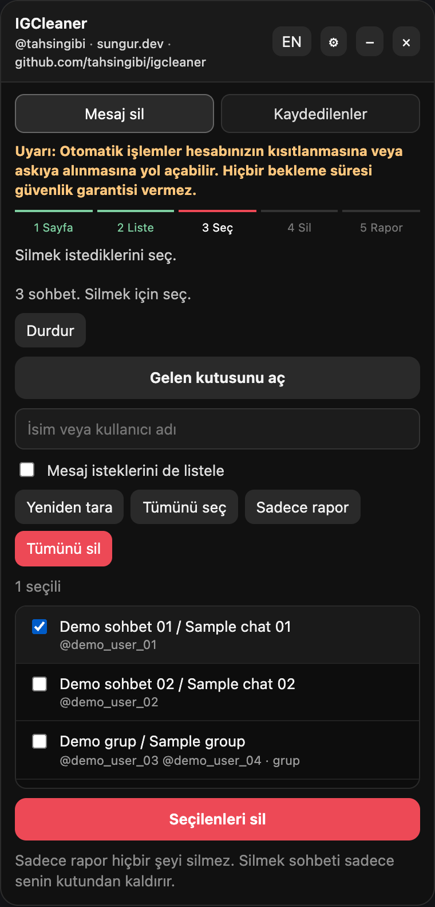

# IGCleaner

[TR](./README.md) · **EN**

A single-file JavaScript tool for managing Instagram chats and saved posts. It runs in your logged-in Instagram tab and opens a floating panel.

> **Warning: Automated actions may result in account restrictions, security verification, or suspension. Delays and stop controls do not eliminate this risk. There is no guarantee that your account will remain unrestricted.**

**[Open igcleaner.js](https://raw.githubusercontent.com/tahsingibi/igcleaner/main/igcleaner.js)**

## Features

- List chats, search by name or username, and delete selected conversations from your own inbox.
- List saved posts, search by username or caption, and remove selected bookmarks.
- Export lists and operation reports as JSON or Excel (`.xlsx`).
- Switch between Turkish and English with one button.
- Configure request delays, break frequency, and break duration.
- Stop an operation from the panel. A request already sent may still complete.

Pasting the code does not start a scan or delete anything. Previously cached results are shown when available; otherwise, the panel waits for you to press **Start scan**.

## Screenshot

The entries shown are fictional and contain no personal data.

## Usage

1. Sign in to [Instagram](https://www.instagram.com/) in a desktop browser.
2. Open [igcleaner.js](https://raw.githubusercontent.com/tahsingibi/igcleaner/main/igcleaner.js) and copy the entire file.
3. In the Instagram tab, open the browser developer tools and select **Console**.
4. Paste the code and press Enter.
5. Choose **Delete chats** or **Saved** in the panel.
6. Open the gear button to adjust settings, then press **Start scan**. Review the results, select items, and follow the confirmation steps. You can export a report without deleting anything.
7. Download the operation report if needed.

No package installation, npm dependency, or separate server is required. After refreshing Instagram, run the script again. Review any code before running it in a logged-in browser tab.

## Language and timing

The language button shows **EN** in Turkish and **TR** in English. Your choice is remembered in the same browser.

The gear button opens **Settings**. The defaults are approximately 4.5 seconds between requests and a 5-minute break after every 5 requests. Request duration and additional operation delays may increase the total time. Minimum settings are 2 seconds between requests and a 30-second break. These are configuration limits, not proven safe usage thresholds. Settings cannot be changed during an operation.

Detected rate limits and security or session errors stop further requests. The tool applies a minimum wait of 1 hour for rate limits and 3 hours for other blocks; a longer server `Retry-After` value takes precedence. These are conservative defaults, not a promise that Instagram's restriction will expire then. Operations never resume automatically.

Cooldowns are stored in the same Instagram origin's browser storage. If storage is unavailable, they are retained only for the running instance. Running the script again stops the previous instance. Closing the panel or pressing Stop attempts to abort active requests, but cannot undo a completed server operation. Refresh Instagram before upgrading from an older version.

## Previous scans

Completed scans are stored in `localStorage` for 24 hours, separately for each account and section. Empty results are cached too. Scans including message requests use a separate entry. Interrupted scans and chat lists collected only from the visible page are not saved as complete scans.

When showing cached results, the panel identifies the previous scan and displays its date and item count. Press **Scan again** to load new chats or newly saved posts. Successfully deleted chats and removed bookmarks are also removed from cached results.

Cached lists may contain usernames, conversation details, and captions. **Settings → Clear saved scans** removes the current account's stored lists. New results may not be saved if browser storage is unavailable or full. Cached scans are not message backups.

## What the actions mean

**Delete chats:** Removes conversations from your own inbox. It does not delete the other person's copy or unsend messages for everyone. This tool cannot restore deleted chats.

**Remove saved posts:** Removes your bookmarks. It does not delete the original posts.

**Reports:** Contain list data and operation results, not message-content backups. They cannot restore deleted chats and may contain personal information. Review them before sharing.

## Privacy and limitations

The script uses your existing Instagram session and reads session cookies and page data locally to send requests to Instagram. It contains no mechanism to send your session information or scan results to the developer's website or a separate backend. It may read Instagram's JavaScript bundles to discover queries. Reports are generated in the browser. Developer links open when clicked.

IGCleaner is not affiliated with or endorsed by Instagram or Meta. It depends on internal endpoints and page structures that may change. Availability of the source code does not mean it has been verified with every account and browser. Request pacing and error handling do not guarantee uninterrupted operation or protection against restrictions.

When reporting an issue, describe the action and error message. Do not share cookies, session tokens, or private message contents.

## Developer

[sungur.dev](https://sungur.dev) · [GitHub / igcleaner](https://github.com/tahsingibi/igcleaner) · [Instagram / @tahsingibi](https://www.instagram.com/tahsingibi/)
