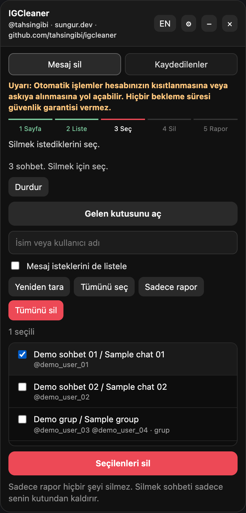

# IGCleaner

**TR** · [EN](./README.en.md)

Instagram sohbetlerini ve kaydedilen gönderilerini tarayıcı üzerinden yönetmek için JavaScript aracı. Instagram sekmesinde çalışır ve sayfanın sağında bir panel açar.

> **Uyarı: Otomatik işlemler Instagram hesabınızın kısıtlanmasına, güvenlik doğrulaması istenmesine veya askıya alınmasına yol açabilir. Bekleme süreleri ve durdurma kontrolleri bu riski ortadan kaldırmaz. Hesabınızın kısıtlanmayacağına dair garanti verilmez.**

**[Kodu aç → igcleaner.js](https://raw.githubusercontent.com/tahsingibi/igcleaner/main/igcleaner.js)**

## Neler yapar?

- Sohbetleri listeler; isim veya kullanıcı adına göre aramana ve seçim yapmana yardımcı olur.
- Seçtiğin sohbetleri kendi gelen kutundan siler.
- Kaydedilen gönderileri listeler ve seçtiklerini kaydedilenlerden kaldırır.
- İşlem sonuçlarını JSON veya Excel (`.xlsx`) olarak indirmene olanak tanır.
- Panelden işlemi durdurmana izin verir. Gönderilmiş bir istek yine de tamamlanabilir.

Kodu yapıştırmak tarama veya silme işlemini başlatmaz. Kayıtlı sonuç varsa gösterilir; yoksa panel hazır durumda bekler. Önce ayarları düzenleyebilir, ardından **Taramayı başlat** düğmesine basabilirsin.

## Ekran görüntüsü

Görüntüdeki kayıtlar kurgusaldır; kişisel veri içermez.

## Nasıl kullanılır?

1. Masaüstü tarayıcında [Instagram](https://www.instagram.com/) hesabına giriş yap.
2. [igcleaner.js](https://raw.githubusercontent.com/tahsingibi/igcleaner/main/igcleaner.js) bağlantısını aç ve kodun tamamını kopyala.
3. Instagram sekmesine dön. Tarayıcının geliştirici araçlarını aç ve **Console / Konsol** bölümüne geç.
4. Kodu yapıştır ve Enter'a bas.
5. Açılan panelden **Mesaj sil** veya **Kaydedilenler** bölümünü seç.
6. Gerekirse ayarları düzenle ve **Taramayı başlat** düğmesine bas. Listelenen öğeleri kontrol et, işlem yapmak istediklerini seç ve paneldeki işlem adımlarını izle.
7. İşlem sonrasında ihtiyaç duyarsan raporu indir.

Kurulum, npm paketi veya ayrıca bir sunucu çalıştırman gerekmez. Sayfayı yenilediğinde aracı yeniden çalıştırman gerekir.

## Dil ve bekleme ayarları

Paneldeki tek dil düğmesi Türkçedeyken **EN**, İngilizcedeyken **TR** gösterir. Tıkladığında dil değişir; seçimin bu tarayıcıda hatırlanır.

Başlıktaki dişli düğmesiyle açılan **Ayarlar / Settings** penceresinde istekler arasındaki süreyi, kaç istekte bir mola verileceğini ve mola süresini değiştirebilirsin. Varsayılanlar yaklaşık 4,5 saniye bekleme ve her 5 istekte 5 dakika moladır. İstek süresi ve işlem içindeki ek beklemeler toplam süreyi uzatabilir. Alt sınırlar 2 saniye bekleme ve 30 saniye moladır; bunlar güvenli kullanım eşikleri değildir. İşlem sırasında ayarlar değiştirilemez.

Kısıtlama veya doğrulama yanıtında yeni istekler durdurulur. Hız sınırında en az 1 saat, diğer engellerde en az 3 saat bekleme uygulanır; sunucunun `Retry-After` değeri daha uzunsa o süre kullanılır. Bu süreler aracın temkinli varsayımlarıdır, Instagram'ın kısıtlamasının kalkacağına dair taahhüt değildir. Süre dolunca işlem kendiliğinden başlamaz. Bekleme aynı Instagram kökenindeki tarayıcı depolamasında tutulur; depolama kullanılamıyorsa yalnızca çalışan kopya boyunca korunur.

Kodu tekrar çalıştırmak önceki kopyayı durdurur. Durdurma veya paneli kapatma, sürmekte olan ağ isteğini iptal etmeyi dener; sunucuya ulaşmış bir işlemi geri alamaz. Eski sürümden geçerken önce Instagram sekmesini yenile.

## Önceki taramalar

Tamamlanan taramalar Instagram hesabı ve bölüm bazında `localStorage` içinde 24 saat saklanır. Aracı yeniden açtığında geçerli bir kayıt varsa yeni istek göndermeden listeyi gösterir; boş listeler de saklanır. Mesaj isteklerinin dahil edildiği taramalar ayrı tutulur. Yarıda kalan ve yalnızca sayfada görünen sohbetlerden oluşturulan listeler, tam tarama kaydı olarak saklanmaz.

Kayıtlı sonuçlar gösterildiğinde panelde **önceki tarama**, tarih ve kayıt sayısı belirtilir. Yeni mesajlar veya sonradan kaydedilen gönderiler için **Yeniden tara** düğmesini kullan. Başarıyla silinen sohbetler ve kaldırılan gönderiler kayıtlı sonuçlardan da çıkarılır.

Kayıtlar kullanıcı adları, sohbet bilgileri ve gönderi açıklamaları gibi kişisel bilgiler içerebilir. Ayarlar penceresindeki **Kayıtlı taramaları temizle** düğmesi mevcut hesabın saklanan listelerini siler. Tarayıcı depolaması kullanılamıyorsa ya da doluysa yeni sonuçlar saklanamayabilir. Bu kayıtlar bir mesaj yedeği değildir.

## İşlemlerin etkisi

**Sohbet silme:** Sohbeti yalnızca kendi gelen kutundan kaldırır. Karşı tarafın kopyasını silmez ve gönderdiğin mesajları herkes için geri almaz. Araç, sildiğin sohbetleri geri yüklemez.

**Kaydedilenlerden kaldırma:** Gönderiyi kendi kaydedilenlerinden çıkarır; gönderinin kendisini silmez.

**Raporlar:** İşlem sonuçlarını içerir. Mesaj içeriklerinin yedeği değildir ve geri yükleme sağlamaz. Kullanıcı adları ve öğe kimlikleri gibi kişisel bilgiler içerebilir; paylaşmadan önce kontrol et.

## Gizlilik ve çalışma biçimi

Kod, açık Instagram oturumunu kullanarak Instagram'a istek gönderir. Oturum için gerekli çerez ve sayfa verilerini tarayıcı içinde okur; bunları geliştiricinin sitesine veya ayrı bir sunucuya gönderen bir mekanizma içermez. Bazı sorguları bulmak için Instagram'ın JavaScript paketlerini de okuyabilir.

Paneldeki geliştirici ve site bağlantıları kullanıcı tıkladığında açılır. İndirilen raporlar tarayıcıda oluşturulur.

Konsolda çalıştırılan kod, açık hesabın üzerinde işlem yapabilir. Çalıştırmadan önce kaynak kodu incele.

## Sınırlamalar

- Instagram veya Meta tarafından geliştirilmiş ya da onaylanmış bir araç değildir.
- Instagram'ın sayfa yapısına ve herkese açık, belgelenmiş bir API olmayan dahili uç noktalarına dayanır. Instagram değişiklikleri aracın çalışmasını etkileyebilir.
- Instagram istekleri sınırlandırabilir. Araçta istek aralıkları ve bazı hata durumlarında durdurma kontrolleri bulunur; bunlar kesintisiz çalışma veya hesabın kısıtlanmayacağı garantisi vermez.
- Bu depoda kodun bulunması, her hesap ve tarayıcıda çalıştığının doğrulandığı anlamına gelmez.

Bir sorun bildirirken yaptığın işlemi ve hata mesajını yazabilirsin. Çerez, oturum anahtarı veya özel mesaj içeriklerini paylaşma.

## Geliştirici

[sungur.dev](https://sungur.dev) · [GitHub / igcleaner](https://github.com/tahsingibi/igcleaner) · [Instagram / @tahsingibi](https://www.instagram.com/tahsingibi/)
